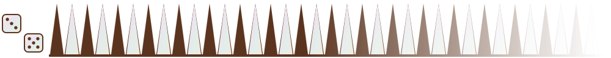
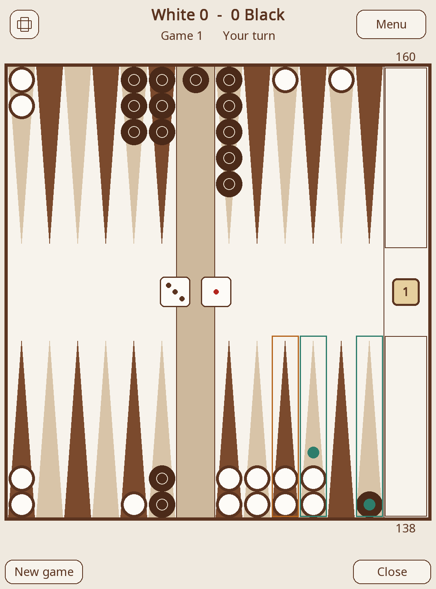
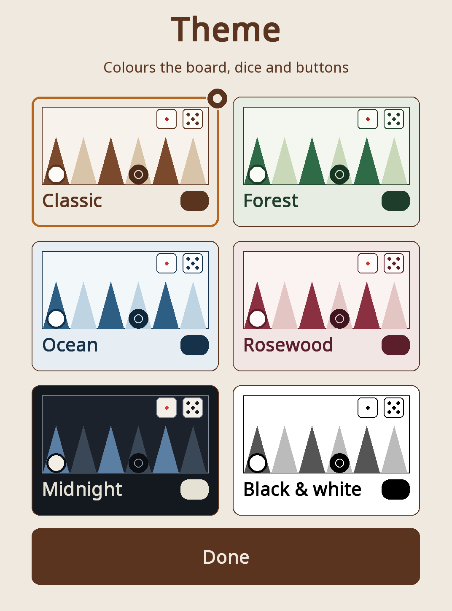
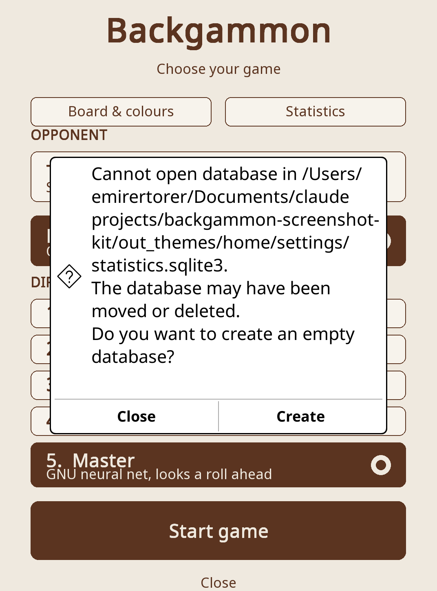
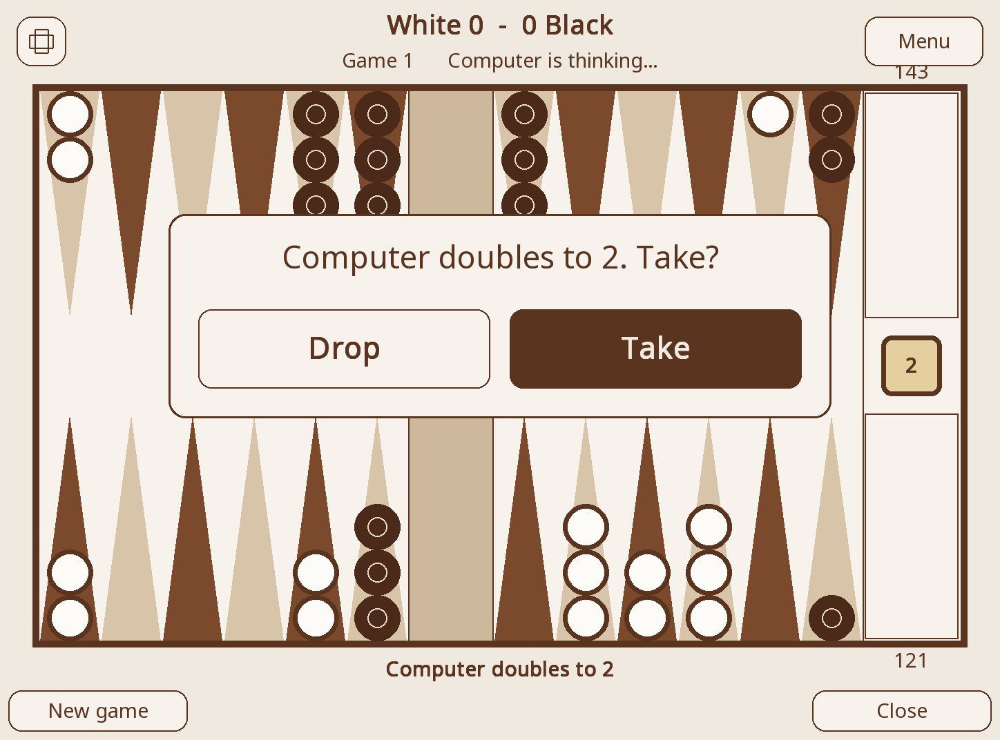
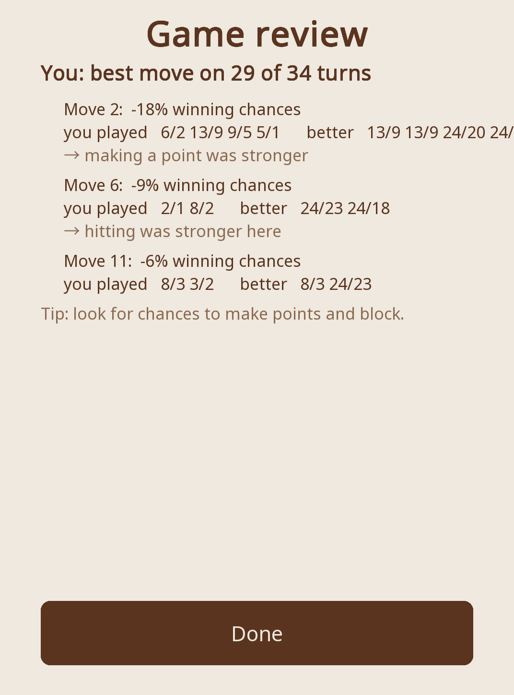

<picture><source media="(prefers-color-scheme: dark)" srcset="assets/backgammon-title-dark.svg"></picture> 

[&color=rgb(239%2C233%2C223))](https://github.com/EmirErtorer/backgammon.koplugin/releases/latest)
[&color=rgb(239%2C233%2C223))](https://github.com/EmirErtorer/backgammon.koplugin/releases)

A **backgammon** (tavla) board for KOReader. Play a friend on the same device, or take on the **computer** at five levels, the top two running **GNU Backgammon's neural network**. On a colour screen it comes in mother of pearl and brown, with six themes to pick from.

<table>
  <tr>
    <td width="33%" valign="top"> Tap a checker and the points it can reach light up.</td>
    <td width="33%" valign="top"> Six themes, from <b>Board &amp; colours</b>.</td>
    <td width="33%" valign="top"> Two players, or the computer at five levels.</td>
  </tr>
  <tr>
    <td colspan="2" width="66%" valign="top"> Landscape at the tap of a button, with the doubling cube on.</td>
    <td width="33%" valign="top"> After the game: your costliest moves.</td>
  </tr>
</table>

## Features

| | |
|---|---|
| **The computer** | Five levels. Levels 1 to 3 are hand written. Levels 4 and 5 run GNU Backgammon's networks in pure Lua, and Master looks a full roll ahead. |
| **Two players** | Share one device. The board can turn round each turn. |
| **Doubling cube** | Optional. Turn it on under **Board & colours**. |
| **Colour and themes** | Classic (mother of pearl and brown), Forest, Ocean, Rosewood, Midnight or Black & white. Board, dice, buttons, menus and dialogs follow the theme, and a one is red. Black and white screens keep the grey look. |
| **Review and statistics** | Every move is compared with the neural network's choice, and your record against each level is kept. |
| **Take back and resume** | Undo steps back through the turn. A game left half way is waiting under **Resume game**. |
| **Portrait or landscape, English or Turkish** | Both orientations are equally fast. |

## Installation

Unzip the download and copy the `backgammon.koplugin` folder inside it into KOReader's `plugins` directory:

- Kindle: `koreader/plugins/backgammon.koplugin/`
- Kobo: `.adds/koreader/plugins/backgammon.koplugin/`
- Android: `koreader/plugins/backgammon.koplugin/` in app storage
- Desktop: the `plugins` folder next to the KOReader binary

Then restart KOReader. Open it from the top menu → **Tools** tab → **Backgammon**.

## License

GPL 3.0 or later (see [`LICENSE`](LICENSE)). The Expert and Master levels use the neural network weights and evaluation from GNU Backgammon, see [`NOTICE.md`](NOTICE.md).
